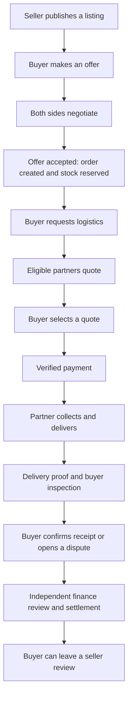

# AkuMart workflow guides

One account can buy, sell, recycle and apply to deliver materials. Signup requires
one account role: **Buyer, Seller, Buyer & Seller, or Recycle & Earn**. There is no
"None" choice. Roles organize your workspace; they do not grant staff permissions
or replace verification and logistics approval.

**Recycle & Earn** is a recycling-first signup choice. It opens My AkuBin without
requiring a buying, selling or logistics role. AkuBin is always visible for every account, with no on/off checkbox. Every account
can use its PIN and earn points, and account roles can be changed in Settings.

With Buyer & Seller selected, use the Buyer/Seller switch in the sidebar. It changes
the dashboard, purchases versus sales, outgoing versus incoming offers and buyer
request actions. Logistics opens the partner application/jobs/deliveries workspace.
Account roles can be changed in Settings. Logistics
partnership applications are available after signing in; Logistics Partner is not
offered in the signup selector.

## Choose your guide

| User | Guide | Main starting page |
|---|---|---|
| Visitor or new member | [Guest and account setup](GUEST.md) | Home, Marketplace, Sign in |
| Buyer | [Buying materials](BUYER.md) | Dashboard / For you |
| Seller | [Selling materials](SELLER.md) | My listings |
| Buy and sell | Read both [Buyer](BUYER.md) and [Seller](SELLER.md) | Switch modes in the sidebar |
| Recycle and earn | [AkuBin recycling](RECYCLING.md) | My AkuBin |
| Delivery business | [Logistics partner](LOGISTICS.md) | Logistics partner |
| Advertiser | [Advertising](ADVERTISER.md) | Advertise |
| Internal team | [Staff roles and operations](STAFF.md) | Staff console |
| Anyone asked to verify | [Verification explained](VERIFICATION.md) | Verification |

## How the main transaction fits together

**Current availability:** the workflow can be exercised through quote selection and
unpaid cancellation. Paystack payment, refunds, settlement and payouts are not configured
for testing. AI and Google sign-in are also unavailable. A completed page or an accepted
quote is not evidence of payment. Do not work around these limits with demo controls.

## Pages shared by account holders

| Page | What it does |
|---|---|
| Dashboard (`/app/dashboard`) | Counts and recent Marketplace orders from your account. |
| For you (`/app/marketplace`) | Suggested listings and articles; All listings opens the full search. Hide a recommendation to remove it from future suggestions. |
| Verification (`/app/verification`) | Basic/full approvals, applications, decisions and history. |
| Notifications (`/app/notifications`) | Updates for your account; mark one or all as read. |
| Support (`/app/support`) | Submit a ticket and see its actual status. |
| Settings (`/app/settings`) | Edit profile details, preferred Marketplace role, interests and AkuBin preference. |
| Logistics partner (`/app/partner`) | Separate application and delivery workspace. |
| Advertise (`/app/advertise`) | Create a campaign using an available package and inspect its statistics. |
| My AkuBin (`/app/akubin`) | Recycling totals, PIN, deposits, sessions and points history. |

## Common rules

- Confirm your email before signing in. Email confirmation and Marketplace verification
  are separate steps.
- Basic Marketplace approval enables offers, listings and buyer-request activity.
- Full approval must match the individual/business type of current basic approval.
  Buyer and seller both need full approval before Marketplace checkout.
- Expired or superseded approvals do not count. Accepting the account terms is also
  required for trading. The backend makes the final access decision.
- Marketplace verification is not required for recycling or reward requests.
- Staff roles must be assigned by an authorized super administrator. A profile setting,
  URL or local role switch cannot grant them.
- An empty page can be correct: it means the backend has no matching visible records.
  A request error is shown separately and must not be mistaken for an empty result.

These guides describe the current backend and frontend. They do not turn on unavailable
providers or constitute a claim that every provider-dependent transition has been tested.
